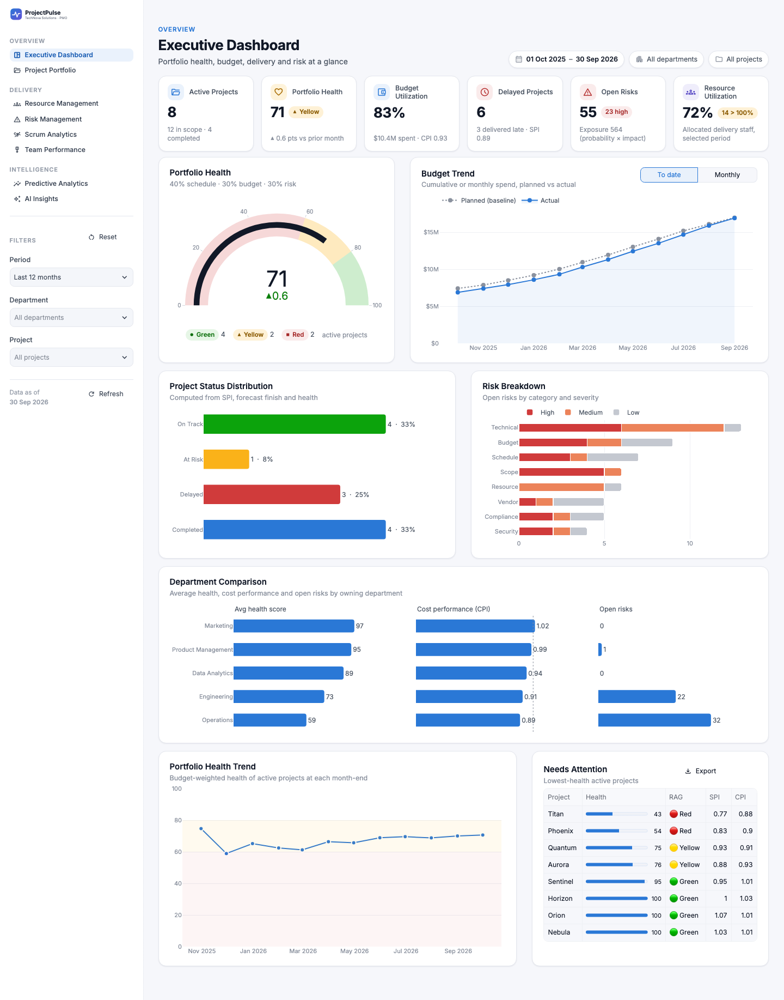
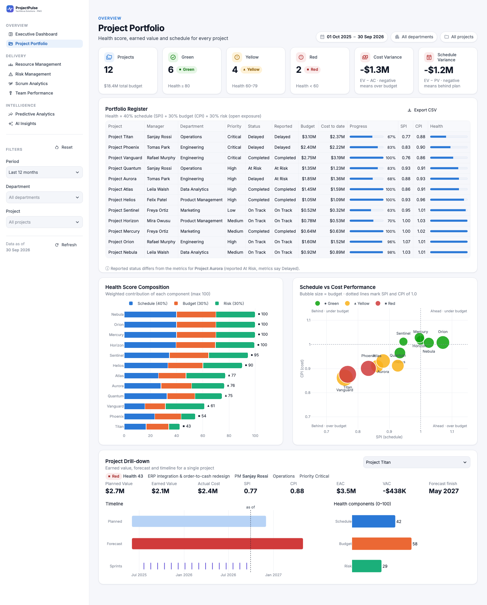
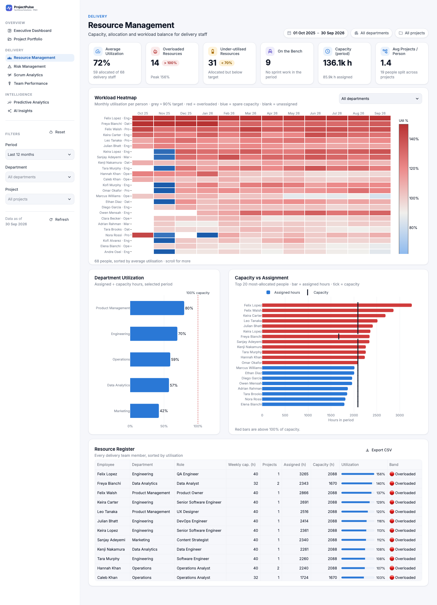
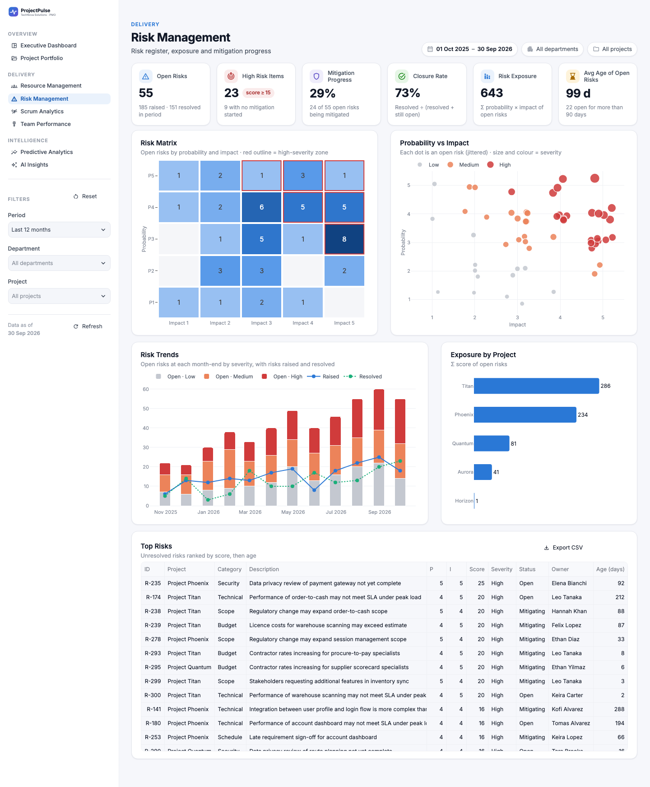
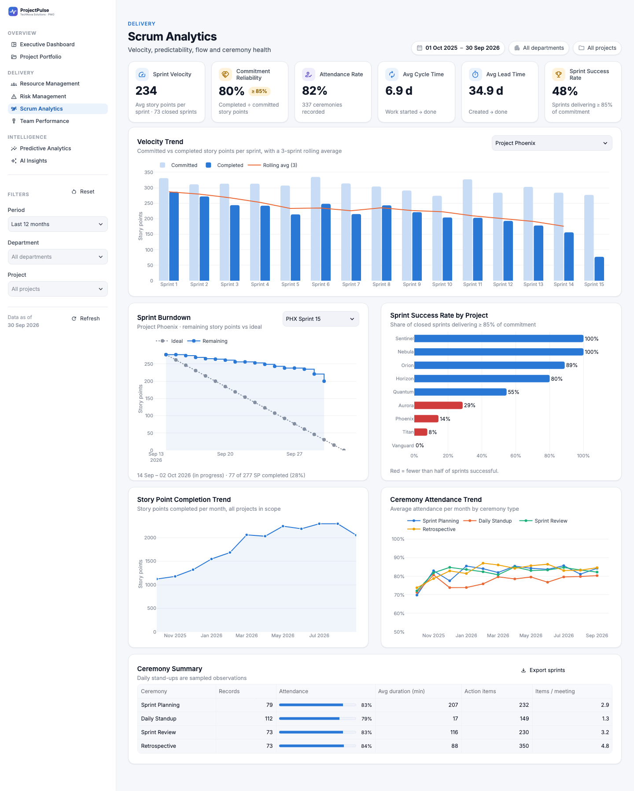
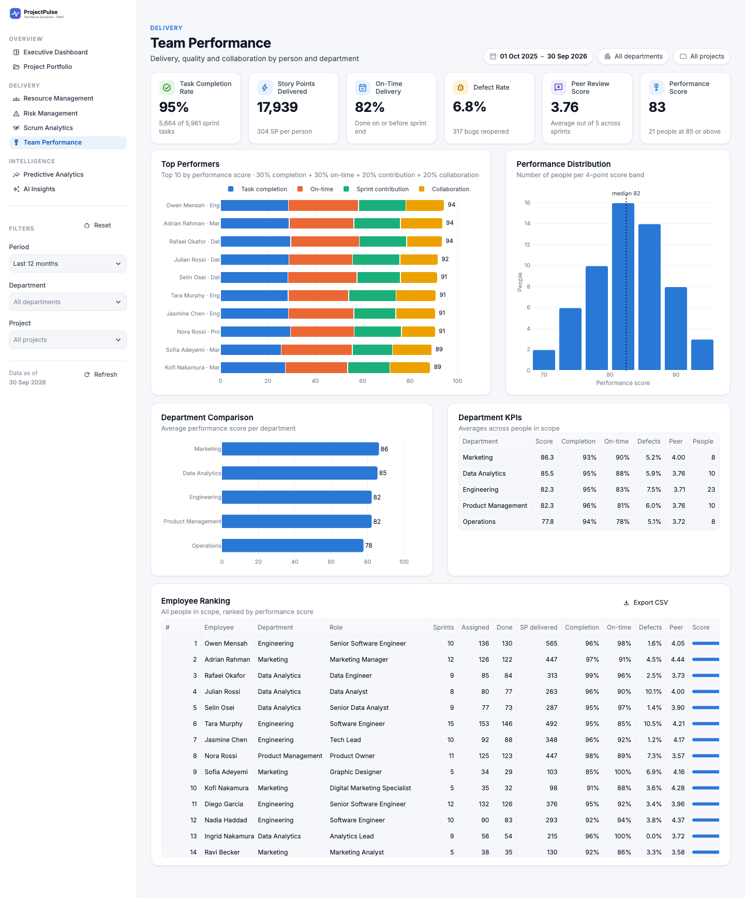
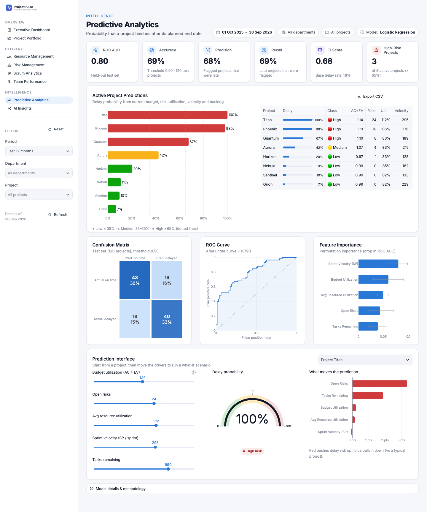
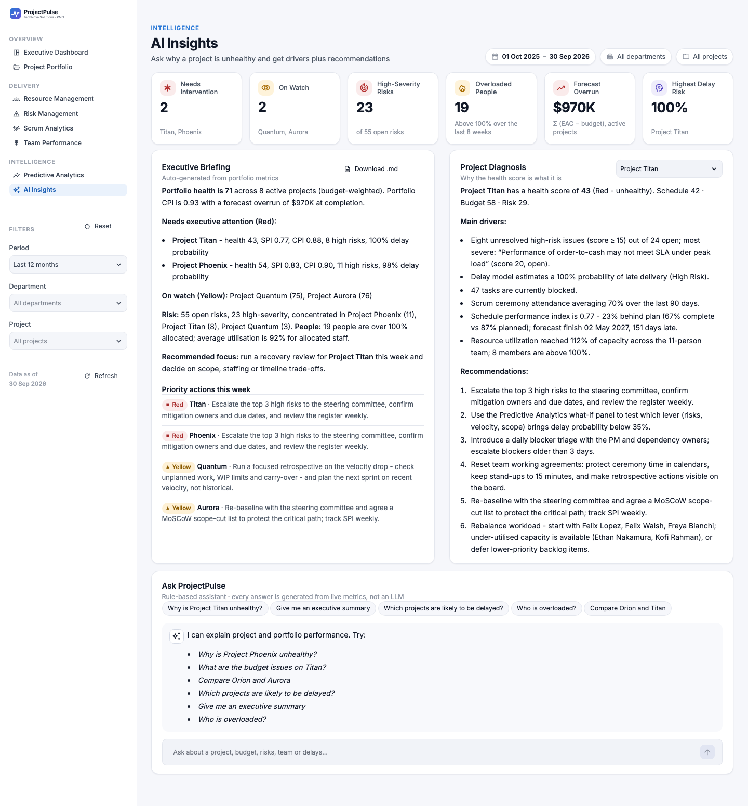
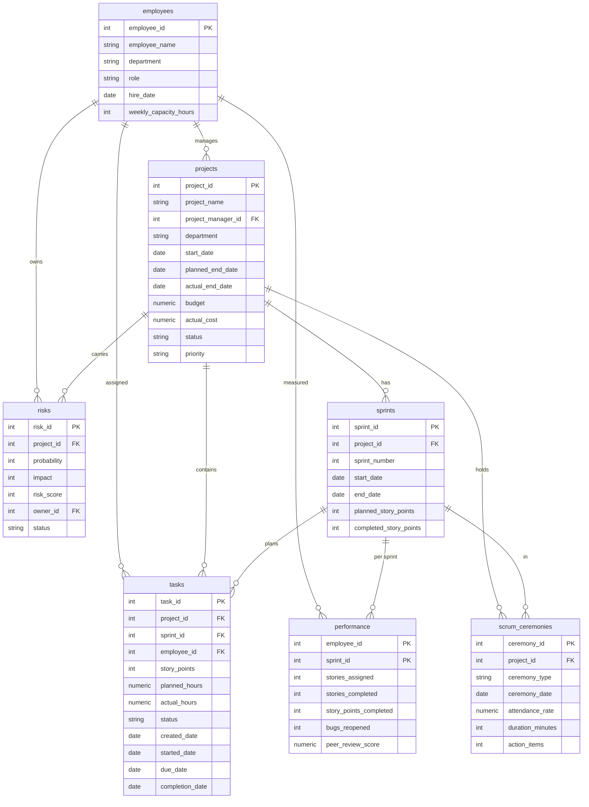

# ProjectPulse

**Project portfolio management and agile analytics platform.** ProjectPulse works like Jira with a PMO analytics layer on top. Executives, project managers, scrum masters and team leads use it to see portfolio health, budgets, risks, agile delivery and team performance. It also predicts which projects will be late and explains why.

Built with **Streamlit · PostgreSQL · SQLAlchemy · pandas · NumPy · Plotly · scikit-learn**. The data is synthetic: Jira-style records for a fictional 75-person company.



---

## Why this project exists

I built ProjectPulse to show a move from **project management** into **data analytics and product management**. It covers the full analytics workflow:

| Skill | Where it shows up |
|---|---|
| **Domain expertise (PMO / Agile)** | EVM (CPI, SPI, EAC, VAC), health scoring, velocity, commitment reliability, ceremony health, risk exposure |
| **Data engineering** | Normalised PostgreSQL schema with constraints and indexes, a reproducible synthetic data pipeline, a bulk loader, analytical SQL views |
| **Data analysis** | Every metric is computed *as of* any date, so moving the date filter replays the portfolio's history |
| **Machine learning** | Delay-probability model with model selection, held-out evaluation, ROC, confusion matrix, permutation importance and what-if explanations |
| **Product thinking** | Eight role-focused pages, insights generated as narrative text, and a recommendation for every problem it flags |

---

## Features

| # | Page | What it answers |
|---|---|---|
| 1 | **Executive Dashboard** | How healthy is the portfolio, and what needs a decision? A one-line summary, four KPIs, a "Needs a decision" list (each Red/Yellow project with its main driver and the recommended action) and the health trend. Budget trend, status, risk and department charts sit under *Show details* |
| 2 | **Project Portfolio** | Which projects are in trouble? A register with green/yellow/red health scores, the health composition, an SPI × CPI quadrant, and a drill-down per project (PV/EV/AC/EAC/VAC, forecast finish, timeline) |
| 3 | **Resource Management** | Who is overloaded? Utilisation KPIs, an employee × month workload heatmap, department utilisation, capacity vs assignment, and a resource register |
| 4 | **Risk Management** | Where is the exposure? A 5×5 risk matrix, a probability × impact scatter, open-risk trends (raised and resolved), exposure by project, and the top-risk register |
| 5 | **Scrum Analytics** | Are teams predictable? Velocity, commitment reliability, attendance, cycle and lead time, sprint success rate, burndown, story-point trend and ceremony attendance |
| 6 | **Team Performance** | Who delivers? Completion, on-time delivery, defect rate, peer review, a weighted performance score, top performers, distribution, department comparison and a ranking |
| 7 | **Predictive Analytics** | Which projects will be late? Live delay probability with a Low/Medium/High class, plus model metrics, confusion matrix, ROC curve, feature importance and an interactive prediction interface |
| 8 | **AI Insights** | *"Why is Project Phoenix unhealthy?"* Generated executive briefing, project diagnosis with ranked drivers and recommendations, and a chat assistant |
| 9 | **Data Import** | Download the Jira / PMO / HR workbook templates, upload filled ones, see every problem by file, sheet, row and column, then replace the data in one transaction. Keeps an import history |

**Built for stakeholders who skim:** every page opens with a one-sentence headline that answers the page's question, then four KPIs and the one or two charts that support it. Secondary charts are collapsed under *Show details*; the sidebar's **Analyst view** switch opens them all.

**Across all pages:** a light design system with sidebar navigation, a global **date filter** (presets or a custom range), **department** and **project** filters with one-click reset, and pills showing the active filters in every page header. Every table exports to CSV.

**Design system:** Inter type and a light, card-based layout. Every page opens with a headline and four KPI cards of identical size, and cards in the same row stretch to equal height. The chart palette is checked for colour-blind safety, and status colours (good, warning, critical) always come with an icon and a label. The layout is responsive: 4 → 2 KPI columns, and cards stack on phones.

<details>
<summary><b>More screenshots</b></summary>

| | |
|---|---|
|  |  |
|  |  |
|  |  |
|  | |

</details>

---

## Folder structure

```
ProjectPulse/
├── app.py                      # Streamlit entry point: theme, navigation, global filters
├── projectpulse/               # Application package
│   ├── config.py               # Settings + business rules (weights, thresholds)
│   ├── models.py               # SQLAlchemy ORM models (mirror sql/01_schema.sql)
│   ├── database.py             # Engine, schema build, bulk load, typed reads
│   ├── data_generator.py       # Synthetic Jira-style data for a fictional company
│   ├── metrics.py              # EVM, health, agile, utilisation and people metrics
│   ├── ml.py                   # Delay-prediction model (train / evaluate / explain)
│   ├── insights.py             # Rule-based AI insights + chat intent router
│   ├── importer.py             # Excel/CSV workbooks -> validated tables; template writer
│   └── ui/
│       ├── theme.py            # Design tokens, palette, Plotly template, CSS
│       ├── components.py       # Page header, KPI grid, cards, chart wrapper, CSV export
│       └── state.py            # Caching, global filters, filtered page context
├── views/                      # One file per page (8 dashboards + Data Import)
├── templates/                  # Blank import workbooks (jira_export, pmo_portfolio, hr_resources)
├── sql/
│   ├── 01_schema.sql           # PostgreSQL DDL (tables, constraints, indexes)
│   ├── 02_views.sql            # Analytical views (EVM summary, sprint metrics, …)
│   └── 03_sample_queries.sql   # Example PMO questions answered in SQL
├── scripts/
│   ├── generate_data.py        # Generate the data set -> CSV
│   ├── load_data.py            # Build schema + load synthetic data + train model
│   ├── import_excel.py         # Validate workbooks and load them (CLI version of Data Import)
│   ├── make_templates.py       # Write blank templates, sample or current-data workbooks
│   └── train_model.py          # Retrain the delay model
├── tests/                      # 48 tests: generator, metrics, ML, insights, DB, importer
├── models/                     # Saved model artefact (generated)
├── assets/                     # Logo + favicon
├── docs/screenshots/
├── .streamlit/config.toml      # Theme: light palette, Inter font, borders, table colours
├── Dockerfile · docker-compose.yml
├── requirements.txt · requirements-dev.txt · .env.example
└── README.md
```

---

## Data model



All seven tables from the brief are implemented with the requested columns. A few columns were **added** so the data behaves like a real Jira export: `tasks.sprint_id`, `issue_type`, `started_date` and `task_key`; `risks.category`, `identified_date`, `resolved_date` and `mitigation_progress`; `sprints.status`; and `scrum_ceremonies.sprint_id`. These are what make cycle time, burndowns and risk trends computable. People are referenced by foreign key (`project_manager_id`, `owner_id`) rather than by name. An eighth table, `project_history`, holds 480 archived project snapshots used to train the model. The DDL in `sql/01_schema.sql` includes CHECK constraints (for example `risk_score = probability * impact`, valid statuses, and Fibonacci story points) plus FK indexes.

### Synthetic data

| Entity | Volume | Notes |
|---|---|---|
| Projects | 12 | 4 completed, 8 active, across 5 departments, with budgets from $0.5M to $3.1M |
| Employees | 75 | Engineering 28, Data Analytics 14, Product 12, Marketing 11, Operations 10 |
| Tasks | 10,000 | Stories, tasks, bugs and spikes, with Jira keys such as `PHX-142` |
| Sprints | 120 | 2–5 week sprints. Active projects have one in-flight sprint |
| Risks | 300 | 8 categories with a full lifecycle (raised → mitigating → closed) |
| Scrum ceremonies | 500 | Planning, review and retro for every sprint, plus sampled stand-ups |
| Performance | ~1,100 | One row per employee per sprint, aggregated from tasks |
| History | 24 months | Oct 2024 – Sep 2026 (snapshot date configurable via `PP_AS_OF`) |

**How the data is generated.** Each project has a hidden health profile: *healthy*, *watch* or *troubled*. That profile drives schedule slip, cost overrun, falling commitment reliability, overloaded teams, more and longer-lived risks, and declining ceremony attendance. Sprint story points are computed from their tasks, cost is computed from earned progress, and performance rows are aggregated from tasks. As a result every number reconciles across pages, and the tests check that it does. The generator is seeded, so the same seed always produces the same data set.

---

## Where the data comes from

In a real PMO the data is spread across systems: delivery work lives in Jira, budgets come from Finance, the risk register is a spreadsheet the PMs keep, and people data comes from HR. ProjectPulse takes one workbook per data owner. Jira is assumed to sync into its workbook (or you drop in Jira's CSV export).

| Workbook | Sheets | Maintained by | Typical refresh |
|---|---|---|---|
| `jira_export.xlsx` | **Issues**, **Sprints** | Jira sync / export | Nightly |
| `pmo_portfolio.xlsx` | **Projects**, **Risks** (RAID log), Ceremonies, Archive | PMO, project managers, scrum masters | Weekly |
| `hr_resources.xlsx` | **Employees**, Peer Reviews | HR, team leads | Monthly |

Bold sheets are required. Blank templates are in `templates/` and on the Data Import page. Each has an *Instructions* tab listing every column, whether it is required and its allowed values, with drop-downs for the fixed lists.

**How the import works**

1. **Sheets link by name, as real exports do.** Issues name their project, sprint and assignee; risks name their owner. Database IDs are assigned during import.
2. **Jira's vocabulary is understood.** `Closed`/`Resolved` → Done, `User Story` → Story, `Highest`/`Blocker` → Critical, and so on. A CSV is recognised by its headers, whatever the file is called.
3. **Every row is validated before anything changes:** required fields, dates, Fibonacci story points, 1–5 risk scales, unknown names, a Done issue without a Resolved date, sprints that belong to another project. Each problem is reported with file, sheet, row and column.
4. **Derived numbers are computed, not typed.** Risk score = probability × impact; sprint committed/completed points and per-person sprint performance are counted from the issues.
5. **One transaction.** All tables are replaced together. If the database rejects anything, nothing changes. Every load is written to `data_imports`, and the delay model retrains.

Optional sheets: without *Ceremonies* the attendance charts are empty; without *Peer Reviews* the performance score uses the other three components; without *Archive* the existing model-training history is kept.

---

## Metric definitions

| Metric | Formula |
|---|---|
| % complete | story points done ÷ total story points in scope |
| Planned % | linear from the first sprint start to the planned end date |
| PV / EV / AC | budget × planned %; budget × % complete; cost to date |
| **SPI** | EV ÷ PV. For completed projects: planned ÷ actual duration (SPI(t)) |
| **CPI** | EV ÷ AC |
| Schedule variance | EV − PV |
| Budget (cost) variance | EV − AC. As a %: (AC − EV) ÷ EV |
| EAC / VAC | budget ÷ CPI; budget − EAC |
| Forecast finish | today + remaining work ÷ delivery rate achieved so far |
| **Risk exposure** | Σ probability × impact of unresolved risks. A mitigating risk counts at (1 − mitigation % ÷ 2) of its score |
| **Project health score** | **40%** schedule health + **30%** budget health + **30%** risk health |
| ↳ schedule health | 100 when SPI ≥ 1, minus 2.5 points per 1% of slippage |
| ↳ budget health | 100 when CPI ≥ 1, minus 3 points per 1% of overrun |
| ↳ risk health | 100 × e^(−exposure ÷ 200) |
| Traffic light | 🟢 ≥ 80 · 🟡 60–79 · 🔴 < 60 |
| Portfolio health | Budget-weighted average health of active projects |
| Velocity | Story points completed in the sprint |
| Commitment reliability | completed ÷ committed story points. A sprint counts as a success at ≥ 85% |
| Lead time / cycle time | created → done / started → done (days) |
| Resource utilisation | planned sprint hours ÷ capacity hours (weekly capacity × working days) |
| Defect rate | bugs reopened ÷ stories completed |
| **Employee performance score** | **30%** task completion + **30%** on-time delivery + **20%** sprint contribution (story points vs. the team-average member, capped at 1.5×) + **20%** collaboration (peer review ÷ 5) |

All weights and thresholds are in `projectpulse/config.py`.

---

## Machine learning: delay prediction

- **Target:** the project finishes after its planned end date.
- **Features:** budget utilisation (AC ÷ EV), open risks, average resource utilisation, sprint velocity and tasks remaining.
- **Training data:** 480 archived mid-project snapshots (`project_history`, 2019–2024).
- **Model selection:** Logistic Regression, Random Forest and Gradient Boosting are compared with stratified 5-fold CV ROC AUC. The winner is evaluated once on a 25% hold-out set. Logistic regression currently wins, with a test ROC AUC of ≈ 0.80.
- **Scoring:** each active project's live metrics are mapped onto the same five features. Projects are classed **Low** (< 35%), **Medium** (35–65%) or **High** (≥ 65%) risk.
- **Explainability:** permutation importance for the model as a whole, plus a per-prediction "what-if" that resets each feature to its typical value and shows how much the probability moves.

> **Caveat:** the archive is synthetic. It was generated from a known logistic process plus noise, so the model shows the workflow rather than real-world accuracy.

## AI Insights

The assistant is **rule-based and needs no API key**. It ranks the drivers behind a project's health (schedule slip, velocity decline, commitment reliability, budget overrun, high risks, team overload, ceremony attendance, blocked work and predicted delay) by severity. It then writes an analyst-style narrative and pairs each driver with a concrete recommendation. A small intent router lets it answer questions such as *"Compare Orion and Aurora"* or *"Who is overloaded?"*. Because every sentence is generated from the metrics, its answers always agree with the dashboards. Swapping in an LLM later only means passing the `Diagnosis` object to the model as context.

Actual output for *"Why is Project Phoenix unhealthy?"* (default data set):

> **Project Phoenix** has a health score of **54** (Red - unhealthy). Schedule 58 · Budget 67 · Risk 36.
>
> **Main drivers:**
> - Eleven unresolved high-risk issues (score ≥ 15) out of 18 open; most severe: "Data privacy review of payment gateway not yet complete" (score 25, open).
> - Team is completing only 61% of committed story points (target 85%).
> - Scrum ceremony attendance averaging 69% over the last 90 days.
> - Delay model estimates a 98% probability of late delivery (High Risk).
> - Schedule performance index is 0.83 - 17% behind plan (83% complete vs 100% planned); forecast finish 01 Dec 2026, 119 days late.
> - Resource utilization reached 106% of capacity across the 10-person team; 6 members are above 100%.
>
> **Recommendations:** 1. Escalate the top 3 high risks to the steering committee… 2. Commit to ~176 SP per sprint (yesterday's weather)… 3. Reset team working agreements… 4. … 5. Re-baseline and agree a MoSCoW scope-cut list… 6. Rebalance workload: start with the three most overloaded people. Under-utilised capacity is available.

---

## Getting started

### Option A: Docker (PostgreSQL included)

```bash
docker compose up --build
# open http://localhost:8501
```

On first start the app container generates demo data, loads PostgreSQL, trains the model and starts Streamlit. Later starts keep whatever data is there.

### Option B: local PostgreSQL

```bash
python -m venv .venv && source .venv/bin/activate      # Windows: .venv\Scripts\activate
pip install -r requirements-dev.txt

# create a database (macOS/Homebrew example)
brew install postgresql@17 && brew services start postgresql@17
createdb projectpulse

cp .env.example .env        # then edit DATABASE_URL, e.g.
# DATABASE_URL=postgresql://<your-user>@localhost:5432/projectpulse

python scripts/load_data.py   # schema + 10,000 tasks + views + model (~6 s)
streamlit run app.py
```

### Option C: zero-setup demo (SQLite)

If `DATABASE_URL` is not set, the app falls back to a local SQLite file. It generates the data automatically on first launch:

```bash
pip install -r requirements.txt && streamlit run app.py
```

### Useful commands

```bash
python scripts/generate_data.py --out data/      # export all tables to CSV
python scripts/train_model.py                    # retrain and print model report
psql "$DATABASE_URL" -f sql/03_sample_queries.sql
python scripts/make_templates.py --sample        # templates/ + filled samples in data/sample/
python scripts/import_excel.py data/sample/*.xlsx --dry-run   # validate only
python scripts/import_excel.py data/sample/*.xlsx             # validate and load
pytest -q                                        # 48 tests
```

---

## Deployment

**Streamlit Community Cloud with a managed PostgreSQL database (Neon, Supabase or Render).**
1. Push the repository to GitHub.
2. Create a free PostgreSQL database and copy its connection string.
3. Load it once from your machine: `DATABASE_URL=<connection-string> python scripts/load_data.py`.
4. On share.streamlit.io, create an app from `app.py`. Under **Settings → Secrets**, add `DATABASE_URL = "<connection-string>"`. Streamlit exposes secrets as environment variables.
5. Deploy. The model trains on first load if `models/delay_model.joblib` is missing.

**Render / Railway / Fly.io:** deploy the `Dockerfile` as a web service, attach a PostgreSQL add-on and set `DATABASE_URL`. On start the container loads demo data only if the database is empty (`load_data.py --if-empty`), so imported spreadsheets survive restarts.

**Production notes:** make `DATABASE_URL` a read-only role for the app and a separate role for loading. Put the app behind SSO with Streamlit's `st.login` or a reverse proxy. Feed real data through the Data Import page or `scripts/import_excel.py` (see *Where the data comes from*).

---

## Roadmap

- Jira Cloud connector (REST API → same schema) and incremental loads
- LLM-backed narrative on top of the rule engine, with metrics passed in as grounded context
- Monte Carlo schedule forecasting from velocity distributions
- Role-based landing pages (executive / PM / scrum master) and saved filter views

---

*Synthetic data only. The company and every person and project in this data set are fictional.*
